<!-- ============================================================
     GitHub Profile README — Animated
     Repo name must match your username: wajihaazeem/wajihaazeem
     Replace anything marked with  <!-- EDIT -->  to personalize.
     ============================================================ -->

<!-- Custom animated hero (assets/hero.svg) -->

<!-- Profile views -->

---

### About Me <!-- EDIT -->

- 🔭 Currently working on **an exciting project**
- 🌱 Currently learning **TypeScript, React & Node.js**
- 💡 Interested in **clean UI, open source & problem solving**
- 📫 Reach me at **your.email@example.com**
- ⚡ Fun fact: **I love turning ideas into reality with code**

---

### Live Terminal <!-- Custom animated terminal (assets/terminal.svg) -->

---

### Tech Stack <!-- EDIT: keep the ones you use, delete the rest -->

---

### GitHub Analytics <!-- Uses your username automatically -->

 

 

---

### Connect With Me <!-- EDIT: replace # with your real links -->

---

---

<i>⭐ Thanks for visiting — let's build something amazing together!</i>

